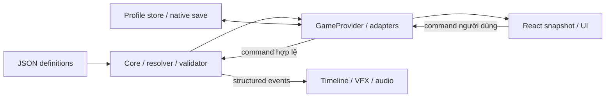
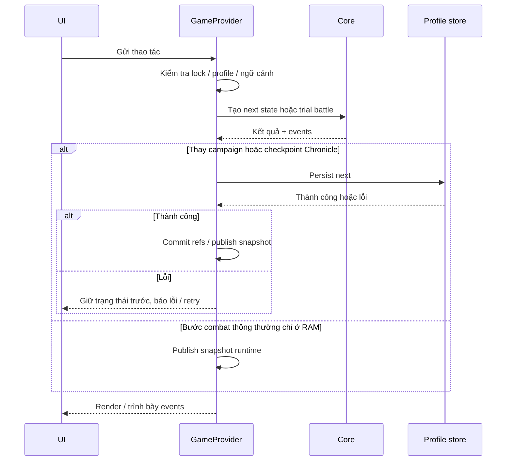

# Kiến trúc hiện hành

Đối chiếu 03/11/2026. Thay tài liệu kiến trúc nguyên mẫu trước React/Level; không giữ các con số cân bằng trong trang này.

## Luồng dữ liệu

`data/*.json` → `scripts/load-content.mjs` / runtime loader → validator `src/core/content.js` → campaign đã migrate → resolver → snapshot trận → command engine → events/snapshot UI.

| Lớp | Điểm vào / trách nhiệm |
| --- | --- |
| Definition | data/characters, abilities, statuses, enemies, encounters và các catalog JSON; ID ổn định |
| Core | battle.js điều phối; module nhỏ về damage, status, mode, tài nguyên, luật lượt, progression, economy |
| Tiến trình | progression.js, leveling.js, skill-progression.js; game-save.js là envelope ứng dụng |
| Runtime | src/runtime/game-context.tsx, profile store/desktop bridge; khóa giao dịch, chờ persist, publish snapshot |
| Trình bày | src/ui tạo copy/preview; src/components render và nhận input; src/app route/CSS |
| Native | src-tauri/src quản lý file hồ sơ, backup, revision; Tauri chạy static out/ |
| Kiểm thử | test/*.test.js core; e2e/*.spec.ts browser; Rust test cho native |

## Ranh giới quan trọng

- Battle dùng RNG riêng và không thuần JSON (có hàm/Set): không structuredClone cả battle tùy tiện. Forecast/AI dùng đường sao chép có sẵn, không tiêu RNG thật.
- Snapshot actor chứa loadout/Rank/nâng cấp lúc xuất phát. Gear hoặc content thay ở ngoài không sửa trận đang chơi. Arena tạo actor ID riêng, giữ characterId/definitionId; mọi quan hệ phe/ô tính tương đối nguồn.
- PvP preparePvpContent clone/validate/deep-freeze luật riêng. Damage cap và loop guard không áp vào PvE auto-farm. arena-ai.js là export tương thích; planner chung ở battle-ai.js.
- Core giải kết quả trước, presentation nhận event có cấu trúc. Không parse log tiếng Việt để suy ra damage, không RNG trong VFX, không thưởng do component mount/replay.
- `isAlive` trong actor-life.js là chuẩn sống/chết, vì Oán Hận có thể sống ở HP0. Không thay bằng hp>0 trong cơ chế dùng chung.
- Các giao dịch kinh tế: clone → validate → persist → publish. Ledger lần đầu, quota, XP và phần thưởng cùng commit; lỗi giữ trạng thái trước, retry không reroll.

## Module theo công việc

| Công việc | Module / doc |
| --- | --- |
| Damage, buff và stat | combat-math.js, stat-values.js, damage-amplification.js, conditional-combat.js |
| Thời hạn / hành động | battle.js, turn-order.js, round-effects.js, charged-buffs.js |
| Mode / triệu hồi | combat-modes.js, combat-summons.js, summon-rules.js |
| Đồng đội / tài nguyên | party.js, arena-identity.js, team-resources.js, powder-combat.js |
| Weakness / Hội Tâm | weakness.js, evasion.js; WEAKNESS_MECHANICS, TRUE_STRIKE |
| Quest / Level enemy | quest-catalog.js, quest-difficulty.js, enemy-scaling.js, quest-rewards.js |
| Dungeon / truyện | dungeon.js, story-waves.js, traveler-stories.js, chronicle-*.js, fortress-*.js |
| Gear / Trấn | equipment.js, blacksmith*.js, gear-*.js, exclusive-*.js |
| Save | game-save.js → serializer/migration progression.js; profiles ở runtime/native |
| Combat UI | battle.tsx, combatant.tsx, combat-effects.tsx, turn-order.tsx; src/ui/combat-timeline.js |

File cụ thể có thể đổi; dùng rg --files trước khi đoán tên. [ENGINE_RULES.md](ENGINE_RULES.md) mô tả contract, [INDEX.md](INDEX.md) dẫn chuyên đề.

## Lưu và phiên

Ứng dụng ghi envelope v7 và key northern-prisma.campaign.v7; serializer nội bộ vẫn có contract v3, không hạ version ứng dụng xuống3. Save thông thường không chứa battle runtime; Chronicle là ngoại lệ có battleSnapshot/RNG qua chronicle-combat.js. Native slot JSON + profiles.json; browser preview dùng localStorage riêng, không giả là AppData.

Dungeon/truyện nhiều wave giữ actor snapshot theo chế độ. Quyển II có activeSession được lưu: đội/gear khóa, HP/MP giữ xuyên các encounter, trạng thái chiến đấu tạo mới. Ngoài session HP/MP, Chronicle còn checkpoint battleSnapshot/RNG để khôi phục trận event qua chronicle-combat.js; không áp quy tắc này sang Quest/dungeon thường. Arena có chính sách xử thua riêng khi bỏ trận. Xem ENGINE_RULES và FORTRESS_SESSION.

Chưa có cloud save, online PvP, chống gian lận server hoặc live banlist/update service. Schema illusion cũ được giữ để tương thích, không phải lộ trình triển khai mới.

## Sở hữu trạng thái và chiều phụ thuộc

Core không import React/DOM/native IPC. Runtime điều phối khóa, persist và publish. Component sở hữu focus/modal/filter/animation, không sở hữu ledger thưởng. JSON là definition, campaign là tiến trình, battle là snapshot sống, React nhận view snapshot; không tráo bốn loại đối tượng này.

## Luồng hành động có tác động dữ liệu

Đây là sơ đồ điều phối, không có nghĩa mọi command core là pure. executeAction sửa battle được truyền vào; transaction kinh tế tạo campaign mới. performCombatStep chỉ tạo trial/checkpoint cho Chronicle. claimReward dùng bản transaction riêng, persist xong mới chuyển cờ rewardClaimed live. Không sao chép mô hình “sửa live rồi undo” sang persistence.

## Ranh giới mở rộng và nợ kỹ thuật

battle.js và game-context.tsx vẫn là điểm điều phối lớn, có nhiều hook chuyên biệt. Module hóa hiện tại không đồng nghĩa đã có plugin registry hoặc event bus tổng quát. Khi thêm cơ chế, ưu tiên module/hook dùng lại, validator và đường trình bày chung; không tự chuyển cả engine sang kiến trúc mới trong task nội dung.

Nên tách tiếp theo bằng một refactor riêng khi có lý do đo được: cùng hành vi đã có test → chuyển trách nhiệm nhỏ → đối chiếu event/result trước sau. Chưa có ngưỡng performance/FPS/throughput được nghiệm thu, CI workflow hoặc hợp đồng online; ghi chúng là công việc chưa chốt, không suy ra từ Astoria technical test.

Quy trình triển khai: [DEVELOPMENT_WORKFLOW](DEVELOPMENT_WORKFLOW.md). Build và rollback: [RELEASE_RUNBOOK](RELEASE_RUNBOOK.md).
